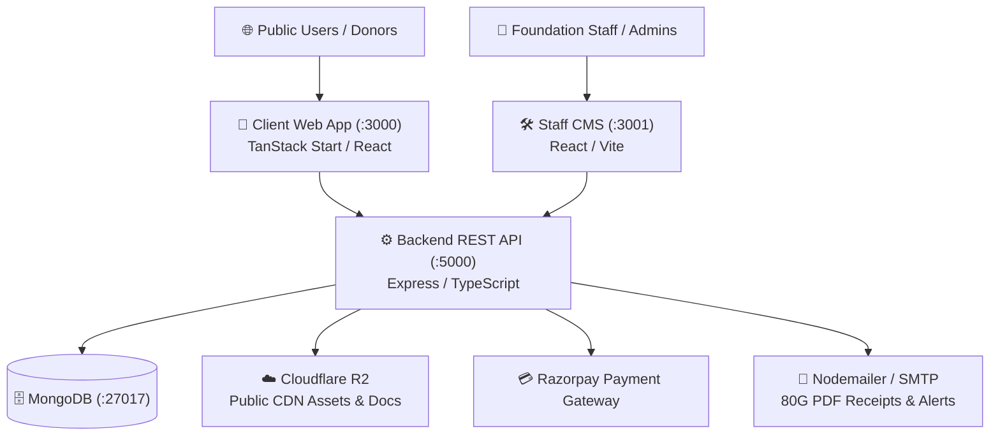

# ISLAH Welfare Foundation Web Platform

<div align="center">


**Bridging Hope, Empowering Lives • Darbhanga, Bihar & New Delhi, India**

[](https://www.iwfindia.org)
[](https://www.iwfindia.org/donate)
[](https://nodejs.org/)
[](https://react.dev/)
[](https://www.docker.com/)

</div>

---

## 📌 Overview

The **ISLAH Welfare Foundation (IWF)** web platform is a unified, production-ready ecosystem comprising a public-facing portal, an administrative Content Management System (CMS), and a robust Node.js backend. Built specifically to power humanitarian, healthcare, education, and livelihood interventions across rural Bihar and pan-India.

### Key Capabilities
- **Direct 80G Donations & Automated PDF Receipts:** Full Razorpay integration with automated server-side A4 PDF tax receipt generation under Section 80G of the Income Tax Act (Order No: `AABTI2820HF2026`).
- **Inbound Applications & Forms Hub:** Manages volunteers, career candidates, CSR/institutional partners, sponsors, and general enquiries with an isolated **Archive Repository**.
- **Live Cloudflare R2 Asset Overrides:** CDN-accelerated document and media storage (`https://pub-9df833ce82f4452db02dda1a3edca3d4.r2.dev`) with bundled fallback fail-safes.
- **Universal Branded Email Engine:** Responsive HTML templates with automatic PDF receipt attachments and zero-cost local mock logging when SMTP is unconfigured.
- **Document & Membership Verification:** Real-time online validation of issued donation receipts, certificates, and community membership cards (`/verify`).

---

## 🏛️ System Architecture



---

## 🚀 Services & Port Mapping

| Service | Port | Container Name | Description |
|---|---|---|---|
| **Client Portal** | `http://localhost:3000` | `islah-client` | Public website, donation flows, programs, membership |
| **Admin CMS** | `http://localhost:3001` | `islah-cms` | Media manager, applications hub, stories, publications |
| **Backend API** | `http://localhost:5000` | `islah-backend` | REST API, PDF generation, Razorpay webhook, emails |
| **MongoDB** | `localhost:27017` | `islah-mongodb` | Primary document database |

---

## 🐳 Quick Start with Docker (Recommended)

Docker Compose bundles MongoDB, Backend, CMS, and Client into a single isolated network.

### 1. Prerequisites
- [Docker Desktop](https://www.docker.com/products/docker-desktop/) installed and running.
- Git.

### 2. One-Click Launch

#### On Windows (PowerShell):
```powershell

```

#### On Linux / macOS (Bash):
```bash
chmod +x scripts/*.sh
./scripts/docker-start.sh
```

#### Or using standard Docker Compose:
```bash
docker compose up --build -d
```

### 3. Check Container Status & Logs
```bash
# Check status
docker compose ps

# Follow logs
docker compose logs -f

# Stop containers
docker compose down
```

---

## 💻 Local Development Setup (Without Docker)

If you prefer running services directly on your host machine:

### 1. Clone & Install Dependencies
```bash
# Clone the repository
git clone https://github.com/ishaanaggrawal101/iwf.git
cd iwf

# Install backend dependencies
cd backend && npm install && cd ..

# Install client dependencies
cd client && npm install && cd ..

# Install CMS dependencies
cd cms && npm install && cd ..
```

### 2. Configure Environment Variables
Copy `.env.example` in `backend`:
```bash
cp backend/.env.example backend/.env
```

Ensure your `backend/.env` has at least:
```env
PORT=5000
MONGODB_URI=mongodb://127.0.0.1:27017/islah_db
JWT_SECRET=your_jwt_secret_key
CLIENT_URL=http://localhost:3000
CMS_URL=http://localhost:3001
```

### 3. Start Development Servers

Open three separate terminals:

```bash
# Terminal 1: Backend API (runs on :5000)
cd backend
npm run dev

# Terminal 2: Admin CMS (runs on :3001)
cd cms
npm run dev

# Terminal 3: Client Portal (runs on :3000)
cd client
npm run dev
```

Or from the root directory using root npm scripts:
```bash
npm run dev:backend
npm run dev:cms
npm run dev:client
```

---

## ⚙️ Environment Configuration

### Backend (`backend/.env`)

| Variable | Required | Default | Description |
|---|---|---|---|
| `PORT` | No | `5000` | Backend API port |
| `MONGODB_URI` | **Yes** | — | MongoDB connection string (Local or Atlas) |
| `JWT_SECRET` | **Yes** | — | Secret key for admin authentication |
| `RAZORPAY_KEY_ID` | Optional | Test key | Razorpay Key ID |
| `RAZORPAY_KEY_SECRET` | Optional | — | Razorpay Key Secret |
| `SMTP_HOST` | Optional | `smtp.gmail.com` | SMTP Server Host |
| `SMTP_PORT` | Optional | `587` | SMTP Port |
| `SMTP_USER` | Optional | — | Gmail / SMTP email address |
| `SMTP_PASS` | Optional | — | Gmail 16-character App Password |
| `FROM_EMAIL` | Optional | `info@iwfindia.org` | Outgoing sender display name & address |
| `ADMIN_ALERT_EMAIL` | Optional | `info@iwfindia.org` | Recipient address for inbound alerts |
| `CLOUDFLARE_R2_PUBLIC_URL` | No | `https://pub-9df...` | Public R2 edge CDN base URL |

> **Note on Email Testing:** If `SMTP_USER` and `SMTP_PASS` are omitted, the backend runs in **Zero-Cost Mock Mode** and prints complete email previews (with attached PDF receipt details) directly to the console without failing or throwing errors.

---

## 📁 Repository Structure

```
iwf/
├── backend/                       # Express + TypeScript REST API
│   ├── src/
│   │   ├── controllers/           # Route controllers (Donation, Application, Contact, etc.)
│   │   ├── models/                # Mongoose schemas (Donation, Application, Contact, Media)
│   │   ├── services/
│   │   │   ├── emailService.ts    # Responsive branded HTML email dispatcher
│   │   │   └── receiptPdfService.ts # Server-side 80G A4 PDF receipt generator (PDFKit)
│   │   ├── scripts/               # Cloudflare R2 asset upload & database sync scripts
│   │   └── server.ts              # Express application entrypoint
│   ├── Dockerfile                 # Multi-stage production container
│   └── package.json
│
├── client/                        # Public Web Application
│   ├── src/
│   │   ├── Pages/                 # Route pages (Home, About, Donate, Programs, Volunteer)
│   │   ├── components/            # Reusable UI components & document generators
│   │   └── services/              # API clients
│   ├── Dockerfile                 # Multi-stage build + Nginx static server
│   ├── nginx.conf                 # SPA routing & reverse proxy configuration
│   └── package.json
│
├── cms/                           # Staff Administrative Management System
│   ├── src/
│   │   ├── pages/                 # CMS Views (MediaManager, ApplicationsManager, StoriesManager)
│   │   └── services/              # CMS API clients
│   ├── Dockerfile                 # Multi-stage build + Nginx static server
│   ├── nginx.conf                 # SPA routing configuration
│   └── package.json
│
├── scripts/                       # Cross-platform automation scripts
│   ├── docker-start.ps1           # Windows PowerShell Docker runner
│   ├── docker-start.sh            # Linux/macOS Bash Docker runner
│   ├── docker-stop.ps1            # Windows PowerShell Docker stopper
│   └── docker-stop.sh             # Linux/macOS Bash Docker stopper
│
├── docker-compose.yml             # Production multi-container orchestration
├── docker-compose.dev.yml         # Development multi-container orchestration
├── package.json                   # Root convenience scripts
└── README.md                      # System documentation
```

---

## 📜 Statutory & Legal Compliance

- **Organization:** ISLAH Welfare Foundation
- **Legal Form:** Section 8 Non-Profit Company (Ministry of Corporate Affairs, India)
- **CIN:** `U85300DL2021NPL388832`
- **PAN:** `AABTI2820H`
- **Income Tax Exemption:** Section 12A (`AABTI2820HE2026`) & Section 80G (`AABTI2820HF2026`)
- **CSR Registration:** Eligible for Corporate Social Responsibility under MCA Form CSR-1.

---

## 🤝 Support & Contact

- **Registered Office:** B-144, Abul Fazal Enclave-II, Jamia Nagar, Okhla, New Delhi - 110025
- **Head Office:** Bathiya, Alinagar / Darbhanga, Bihar - 847103
- **Email:** [info@iwfindia.org](mailto:info@iwfindia.org)
- **Helpline:** +91 92588 95224
- **Web:** [www.iwfindia.org](https://www.iwfindia.org)
